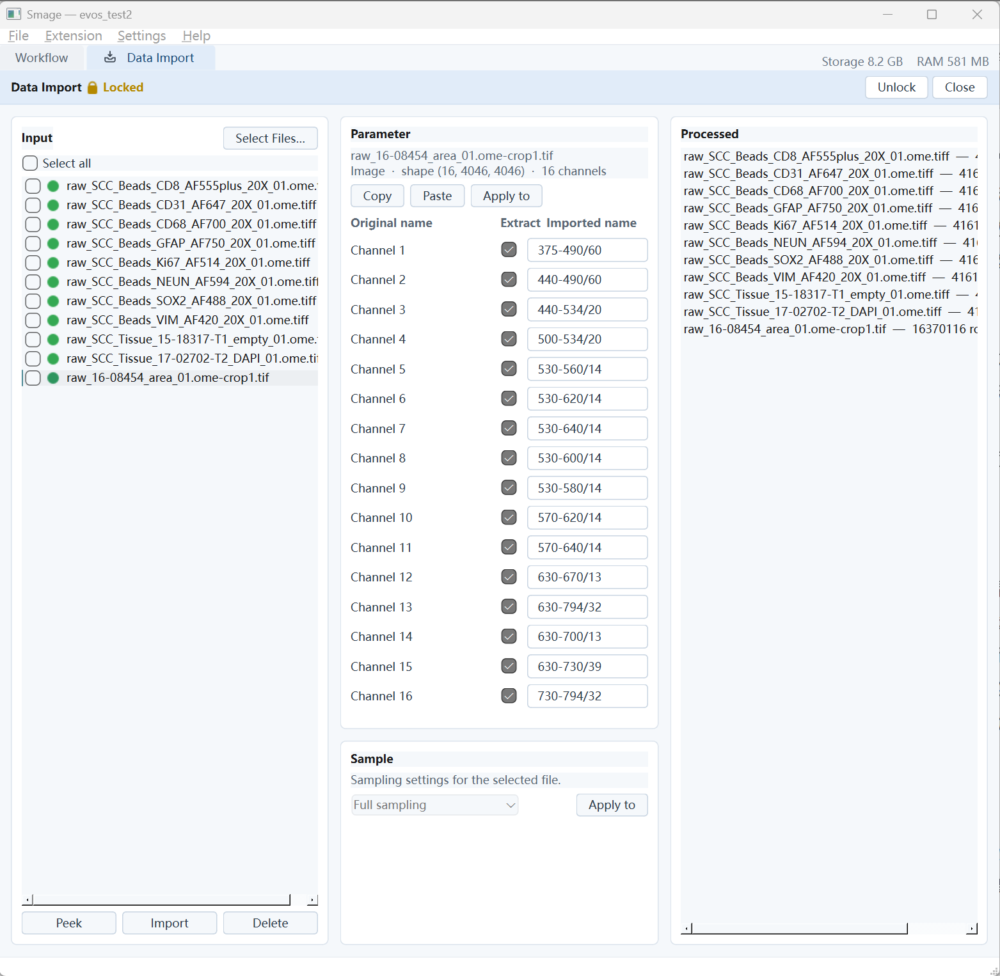
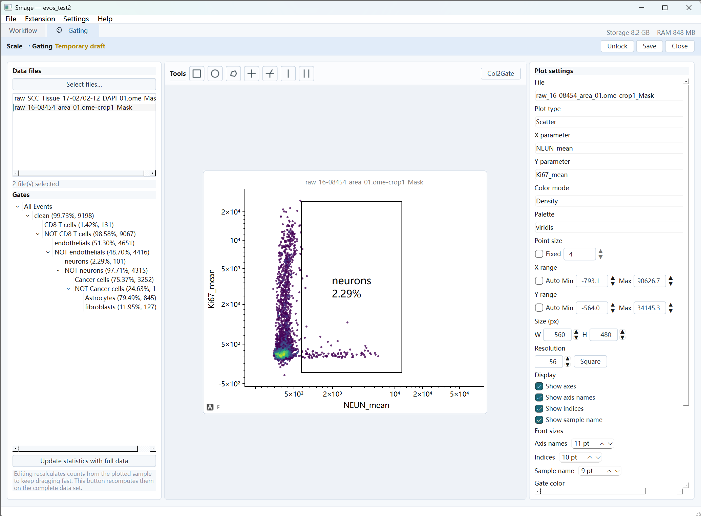

# Quick start

This walkthrough creates a project, imports data, gates a population and
exports the result.

## 1. Create a project

`File → New Project…`, choose a parent folder and a name. Smage creates a
folder named `<name>.smage` that will hold the imported data, module settings,
generated files and the log.

## 2. Import data

1. Add a **Data Import** module from the workflow tree (it already exists in
   a new project).
2. Click **Add files…** and choose `.fcs` files, TIFF/OME images or tabular
   files.
3. Review the parameter list: tick the columns to keep, rename them if needed,
   and choose how image channels are extracted.
4. Select the files and press **Import**.

The imported data appears as a new *processed* file that downstream modules
can read.

## 3. Add modules

Click **Add module** in the workflow tree and choose what the data should
flow through. Typical first steps:

- **Compensation** — apply a spillover matrix to flow-cytometry channels.
- **Gating** — draw gates and get counts and percentages.
- **Figure** — scatter or histogram plots at any point of the pipeline.

Each module has its own settings, a **Save** button and, for modules that
produce data, a **Run** / **Calculate** action. Downstream modules only see
the saved state of the modules above them.

## 4. Gate a population

1. Open **Gating** and pick the x/y parameters in the plot settings.
2. Choose a tool (rectangle, ellipse, polygon, quadrant, split or range) and
   draw in the plot.
3. The gate tree shows the count and percentage per gate. Dragging a gate
   updates them when you release the mouse; **Update statistics with full
   data** recalculates on every row instead of the displayed sample.
4. Add child gates by selecting a gate and drawing inside it; boolean gates
   (NOT/AND/OR) combine existing gates.

## 5. Look at the result

Open a **Figure** or **Heatmap** module below the gate to visualise the
result, [Export](../modules/export.md) it to CSV/parquet, or feed it into
**Feature Down** to aggregate per class.

## Next

- [Projects and data](project-and-data.md) — what is inside a `.smage` folder
- [Modules overview](../modules/index.md)
- [FCS workflow guide](../guides/fcs-workflow.md)
