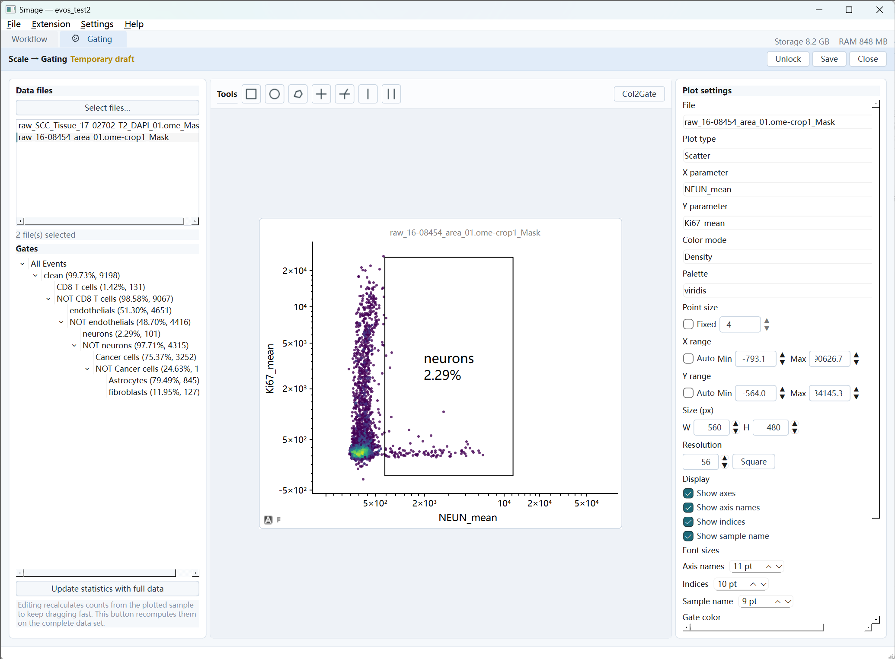

# FCS workflow

A complete flow-cytometry analysis: import, scale/compensate, gate, visualise
and export.

## 1. Import

1. `File → New Project…`.
2. In **Data Import**, add the `.fcs` files.
3. Tick the parameters to keep; rename them if you prefer marker names.
4. **Import** the selected files.

## 2. Scale and Compensation (optional)

These two are usually used together. **Scale** is the more common first step:
add a Scale module and set `log10` or `arcsinh` on the channels you plot. It is
display-only — values, gates and statistics stay in the original units — so it
never changes the analysis, only what you see.

**Compensation** is needed when spillover between channels matters. Add it
below Scale (the order does not matter, because Scale never changes the data):

1. Set the channels in matrix order.
2. Enter or paste the spillover matrix (percentages).
3. **Save** the module so downstream modules see the compensated values.

!!! tip
    Paste a matrix straight from the cytometry software's report: select the
    matrix in the spreadsheet, copy, then use **Paste matrix**. Channel names
    must match the selected channels.

!!! tip
    Many analyses only need Scale. Skip Compensation when the panel has little
    spillover or when you only compare ratios.

## 3. Gating

1. Add a **Gating** module.
2. Pick the x/y parameters in **Plot settings**.
3. Draw a rectangle or polygon gate, then select the gate and draw inside it
   for children.
4. Watch counts and percentages in the gate tree. They update when you release
   the mouse; **Update statistics with full data** recalculates on every event.
5. Add boolean gates (NOT/AND/OR) to combine populations.

## 4. Visualise

Add a **Figure** module below the gate, choose *Scatter*, pick the same
parameters and set **Filter** to the gate you want to show. Add more plots to
the same module as needed.

## 5. Export

1. Add an **Export** module.
2. Select the data files and plots to write.
3. Choose the output folder and formats (CSV/Parquet, PNG/SVG/PDF).
4. **Export**.

## Notes

- Use [Subsample](../modules/subsample.md) above heavy clustering steps to keep
  them fast.
- The project folder keeps every setting, so the whole analysis can be reopened
  and reproduced later.
