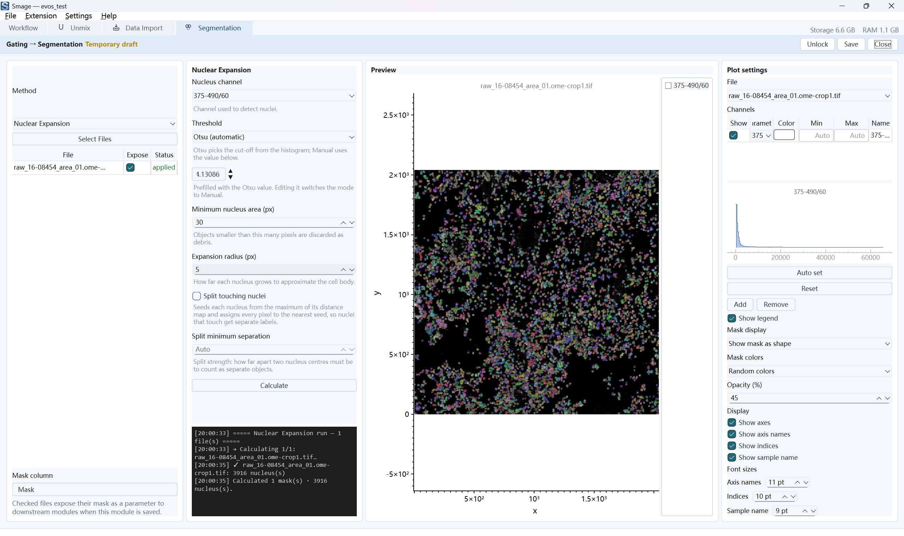

# Image workflow

Segmenting microscopy images, aggregating per-object features and comparing
populations between samples.

## 1. Import the images

1. `File → New Project…`.
2. In **Data Import**, add your TIFF/OME-TIFF files.
3. Choose which channels to extract and name them (for example `DAPI`,
   `CD31`, `CD8`).
4. **Import**.

Every pixel becomes a row with its `x`, `y` and channel values.

## 2. Optional: unmix and correct

- Add **Unmix** when channels overlap spectrally; define the spectra and let
  Smage solve the per-pixel contributions.
- Add **Illumination Correction** when the field is unevenly lit; estimate the
  correction map with **Auto set** and save.

## 3. Segment

1. Add a **Segmentation** module.
2. Choose the method (Threshold, Cellpose or StarDist).
3. Select the **nucleus channel** and adjust threshold/area/expansion.
4. **Calculate** the mask. The mask column becomes available downstream.

!!! note
    Cellpose and StarDist run in the separate Python environment created by the
    **Extension Manager**. The first run downloads the model.

## 4. Aggregate per object

1. Add **Feature Down**.
2. Set **Feature channel** to the mask column.
3. Add one aggregation rule per marker (for example `Mean` of `CD8`).
4. Check the **Background ignore** values so the background label is excluded.
5. **Calculate** — one row per segmented object is written per image.

The default rules table already contains the Count row and a group-key row
named after the feature channel; the group-key row can be deleted if you do
not want the identifier column in the output.

## 5. Compare and visualise

- **Heatmap** for a clustered view of the per-class features.
- **Gating** on the aggregated table to define cell-type combinations.
- **Figure** to plot marker intensities per population.
- **Export** to write the feature tables.

## Notes

- Areas per class can be measured with [Area](../modules/area.md).
- Feature Up can map per-class values back onto individual objects for
  plotting.
