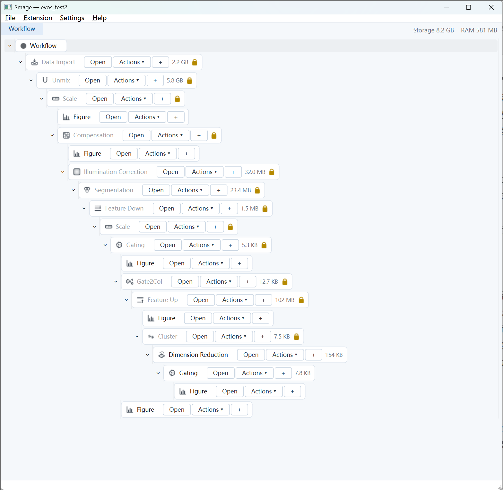
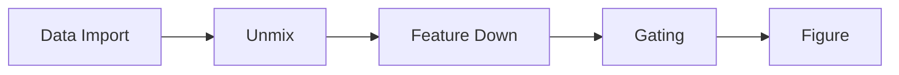
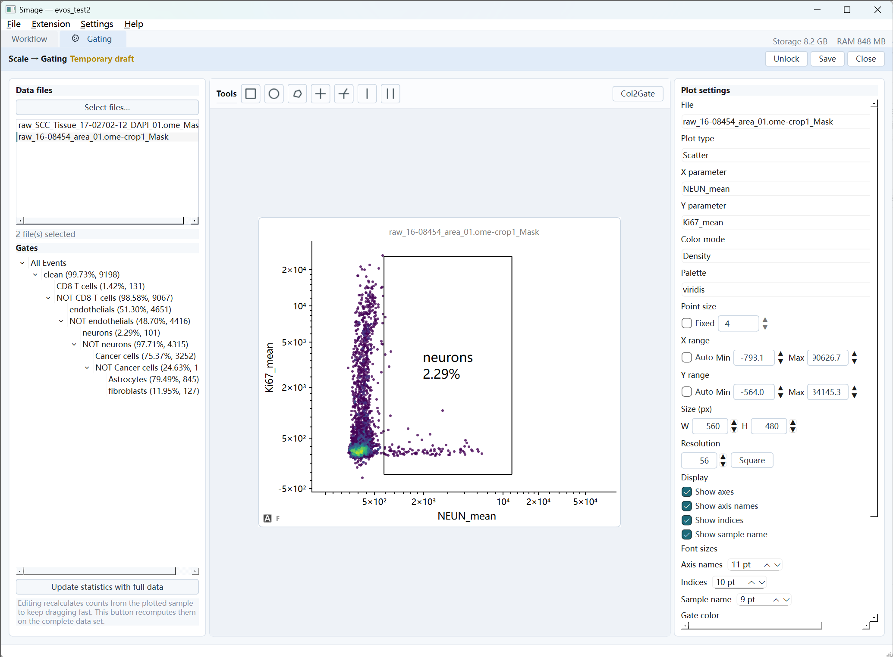

# Smage

**Free, open-source desktop analysis for spectral image and flow-cytometry
data.**

Smage imports FCS files and microscopy images into one tabular model and
lets you build analysis pipelines from interactive modules — gating,
compensation, unmixing, segmentation, clustering, feature tables and export.

[Download the latest release :material-download:](https://github.com/xiangmingcai/smage/releases/latest){ .md-button .md-button--primary }
[Get started](getting-started/quickstart.md){ .md-button }

!!! info "Status"
    Smage is in early development (`0.5.5`). Modules, file formats and
    settings may still change between releases. Windows 10/11 (64-bit) only.

## What you can do

-   :material-file-import: **Import anything**

    ---

    `.fcs` files, TIFF/OME image stacks and tabular data become the same
    row-per-observation table that every module understands.

-   :material-flask-outline: **Unmix spectra**

    ---

    Extract reference spectra from the image channels before unmixing.

    <video class="clip" muted loop playsinline preload="none"
           poster="assets/videos/extract-spectra-poster.jpg">
      <source src="assets/videos/extract-spectra.mp4" type="video/mp4">
    </video>

-   :material-check-decagram-outline: **Check unmixing**

    ---

    Inspect the unmixed channels and residuals before mapping the result.

    <video class="clip" muted loop playsinline preload="none"
           poster="assets/videos/unmix-qc-poster.jpg">
      <source src="assets/videos/unmix-qc.mp4" type="video/mp4">
    </video>

-   :material-selection-drag: **Gate interactively**

    ---

    Rectangle, ellipse, polygon, quadrant, split and range gates, boolean
    gates, per-file gate shapes, and live gate statistics.

    <video class="clip" muted loop playsinline preload="none"
           poster="assets/videos/gating-poster.jpg">
      <source src="assets/videos/gating.mp4" type="video/mp4">
    </video>

-   :material-image-filter-center-focus: **Analyse images**

    ---

    Cellpose, StarDist and Nuclear Expansion segmentation; Region detection
    with Signal Expansion; per-Region pixel area; and per-class feature
    aggregation.

    <video class="clip" muted loop playsinline preload="none"
           poster="assets/videos/segmentation-poster.jpg">
      <source src="assets/videos/segmentation.mp4" type="video/mp4">
    </video>

-   :material-vector-polygon: **Detect Regions**

    ---

    Detect tissue, perivascular space, and special areas with Signal
    Expansion, edit in/out boundaries on the image, convert each Region to
    a 0/1 channel and measure its pixel area.

    <video class="clip" muted loop playsinline preload="none"
           poster="assets/videos/region-poster.jpg">
      <source src="assets/videos/region.mp4" type="video/mp4">
    </video>

-   :material-chart-scatter-plot: **Explore**

    ---

    UMAP / t-SNE, clustering (PhenoGraph, Leiden, FlowSOM, PARC), feature
    heatmaps and publication-ready figures.

    <video class="clip" muted loop playsinline preload="none"
           poster="assets/videos/cluster-umap-heatmap-poster.jpg">
      <source src="assets/videos/cluster-umap-heatmap.mp4" type="video/mp4">
    </video>

-   :material-image-multiple-outline: **Visualise with Figure**

    ---

    Scatter, histogram, image and N×N plots. Image plots overlay several
    layers on one image — raw channels, segmentation masks, converted Region
    channels and cell-type labels from gates — each with its own colour,
    range and opacity.

-   :material-table: **Build feature tables**

    ---

    Aggregate per class with Feature Down, map values back to events with
    Feature Up, and turn gates into columns.

-   :material-export: **Export**

    ---

    CSV, parquet and plot images straight from the workflow.

## How it works

Every step is a **module** in the workflow tree. A module sees the data
produced upstream, applies its settings, and passes the result down. This
makes an analysis reproducible inside one `.smage` project folder rather
than a chain of ad-hoc scripts.

## Documentation

- [Installation](getting-started/installation.md) — download, SmartScreen, requirements
- [Quick start](getting-started/quickstart.md) — first project in five minutes
- [Modules](modules/index.md) — what each module does and how it is configured
- [FAQ](reference/faq.md) — where the logs are, common problems

## License

Smage is free software under **GPL-3.0**, released with the approval of
Amsterdam UMC, the Netherlands. Copyright (C) 2026 Amsterdam UMC. The source
code is on [GitHub](https://github.com/xiangmingcai/smage).

!!! warning "Research use only"
    Smage is research software, not a medical device, and must not be used
    for clinical diagnosis or decision-making. It comes without warranty, and
    you are responsible for the analysis and its results. See
    [DISCLAIMER.md](https://github.com/xiangmingcai/smage/blob/main/DISCLAIMER.md)
    for the full statement.
