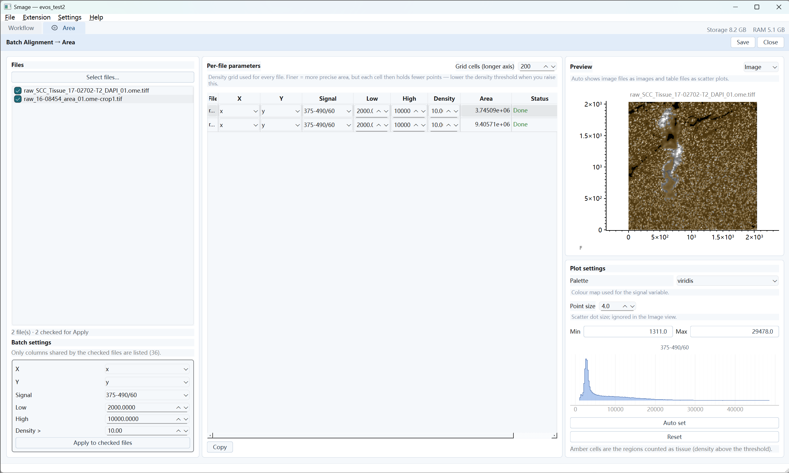

# Area

Measures the area covered by a population in a 2-D embedding or scatter plot,
using a density grid and an intensity threshold.

## Settings

| Setting | Description |
|---|---|
| Files | The files to measure; checked files receive the batch settings. |
| X / Y | The two columns that define the plane (for example a UMAP embedding). |
| Channel | The channel whose intensity defines the area (for example a marker). |
| Low / High | The channel values used to estimate the per-cell intensity. |
| Density > | Minimum point density (points per grid cell) that counts as occupied. |
| Grid cells (longer axis) | Resolution of the density grid; finer grids give a more precise area but a stricter threshold. |

Batch settings can be applied to every checked file at once, and per-file
parameters can be adjusted afterwards. The preview shows the density map,
palette and point size.

## Output

An area value per file (and per class, when filtered by a gate), available to
downstream modules and export.

## Notes

- The density threshold is expressed in points per grid cell, so changing the
  grid resolution changes the threshold's meaning. Keep the grid fixed when
  comparing files.
- Use a [Subsample](subsample.md) module above Area to keep the grid
  calculation fast on large files.

## Related

[Segmentation](segmentation.md) · [Figure](figure.md) · [Subsample](subsample.md)
