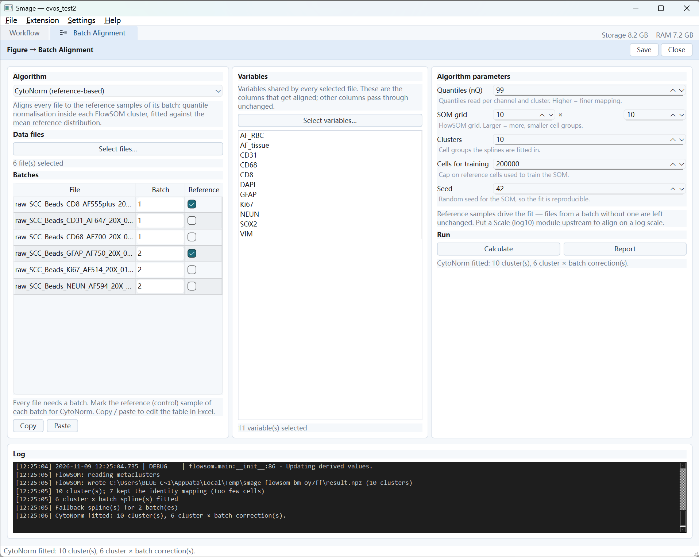

# Batch Align

Aligns measurements across acquisition batches so that batches can be compared
or clustered together. Two methods are available:

| Method | Needs reference samples | Best for |
|---|---|---|
| **CytoNorm** (reference-based) | Yes — one per batch | Panels measured with the same reference material in every batch |
| **ComBat** (reference-free) | No | Experiments without reference samples; corrects location and spread from the data itself |

## Common settings

| Setting | Description |
|---|---|
| Files | The files to align. |
| Columns | The channels the alignment is computed on. |
| Batches | Batch assignment per file (editable column in the file table). |

## CytoNorm (reference-based)

| Setting | Description |
|---|---|
| Reference | Tick the reference sample of each batch in the **Reference** column. |
| Quantiles (nQ) | Quantiles read per channel and cluster. Higher = finer mapping. |
| SOM grid | FlowSOM grid size. Larger = more, smaller cell groups. |
| Clusters | Number of cell groups the splines are fitted in. |
| Cells for training | Cap on reference cells used to train the SOM. |
| Seed | Random seed for the SOM, so the fit is reproducible. |

CytoNorm fits a per-batch mapping from the reference samples onto the target
distribution. A batch without a reference file is left uncorrected (the log
says so).

!!! note "Extension required"
    CytoNorm trains with FlowSOM. Install the FlowSOM extension from
    **Extension → Manage Extensions** before calculating; the Calculate button
    stays disabled until it is configured.

## ComBat (reference-free)

| Setting | Description |
|---|---|
| Empirical Bayes shrinkage | Pull each batch estimate towards the pooled value. Safer when a batch has few cells. |
| Adjust variance as well as location | Also equalise the spread, not just the median. Off = shift means only. |

ComBat estimates the batch effect from the data, so it does not need reference
samples. It works best when every batch has a reasonable number of cells and
the batches overlap in marker space.

## Output

Aligned values for the selected columns; downstream modules see them under the
same names.

## Notes

- The **Report** button writes an HTML/PDF report comparing the before/after
  distributions per batch and channel — a quick way to check that alignment
  did not distort the biology.
- Training runs on a bounded number of events per file, so very large files do
  not slow the module down.

## Related

[Compensation](compensation.md) · [Cluster](cluster.md)
