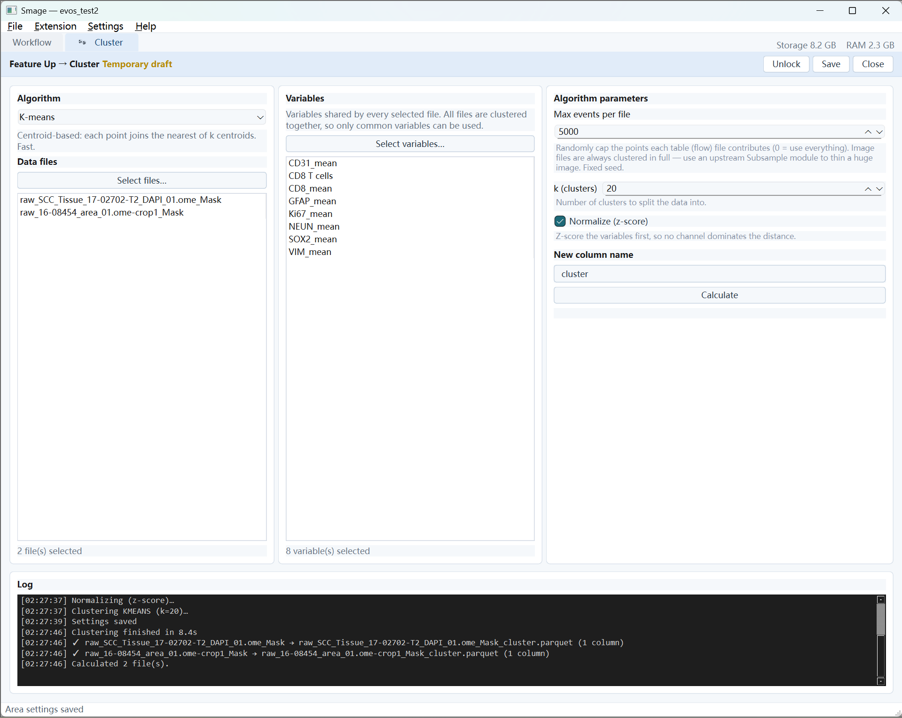

# Cluster

Groups events by similarity and adds a cluster label column that downstream
modules can use as a feature channel.

## Methods

| Method | Notes |
|---|---|
| K-means | Fast, expects roughly spherical clusters; you choose k. |
| FlowSOM | Self-organising map + metaclustering; runs in the external extension environment. |
| PhenoGraph | k-nearest-neighbour graph + Louvain; finds irregular and rare populations. |
| Leiden | kNN graph + Leiden; a good default for single-cell data. |
| DBSCAN | Density-based; labels sparse events as noise. |
| Hierarchical | Agglomerative clustering. |
| PARC | Phenograph-based clustering; runs in the external extension environment. |

## Settings

| Setting | Description |
|---|---|
| Files | The files to cluster. |
| Channels | The channels used to compute distances. |
| Max events per file | Upper bound on the events used for training. |
| Method parameters | Per-method options (k, resolution, number of clusters, epsilon, …). |
| New channel name | The name of the resulting label column. |

## Output

A cluster label per event, exposed as a column to downstream modules.

## Notes

- FlowSOM and PARC are not bundled; install them from the
  **Extension Manager** into a separate Python environment.
- Cluster labels are integers; use them as the **feature channel** in
  [Feature Down](feature-down.md) to build per-cluster feature tables.

## Related

[Dimensionality Reduction](dimred.md) · [Feature Down](feature-down.md) · [Heatmap](heatmap.md)
