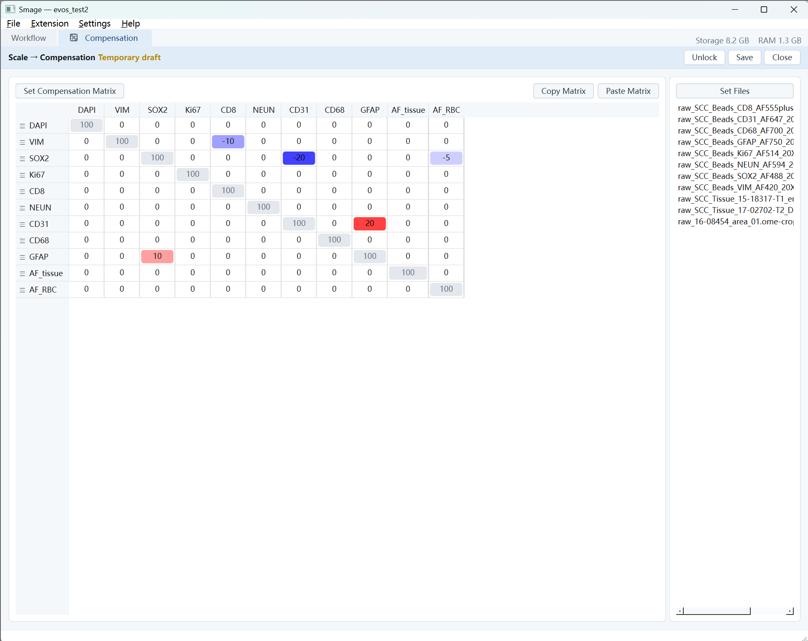

# Compensation

Applies a spillover (compensation) matrix to flow-cytometry channels so that
signal from one fluorophore does not leak into another.

## Settings

| Setting | Description |
|---|---|
| Files | The files the matrix applies to. |
| Channels | The channels in the matrix, in row/column order. |
| Matrix | Spillover percentages. `100` on the diagonal means "keep this channel as is"; off-diagonal values are the percentage subtracted. Values are entered as percentages (100 = 100 %), not fractions. |

You can paste a matrix from a spreadsheet with **Paste matrix** — the first
row and column are channel names and must match the selected channels.

## Output

Compensated values for every selected channel. Downstream modules see the
compensated columns under the same names; the raw values are never modified.

## Notes

- The matrix is applied per file, only to the files listed in this module.
- Save the module to make the matrix visible to downstream modules. Modules
  that were already open refresh their data after the save.
- Gate statistics and plots always use the saved matrix.

## Related

[Unmix](unmix.md) · [Gating](gating.md)
