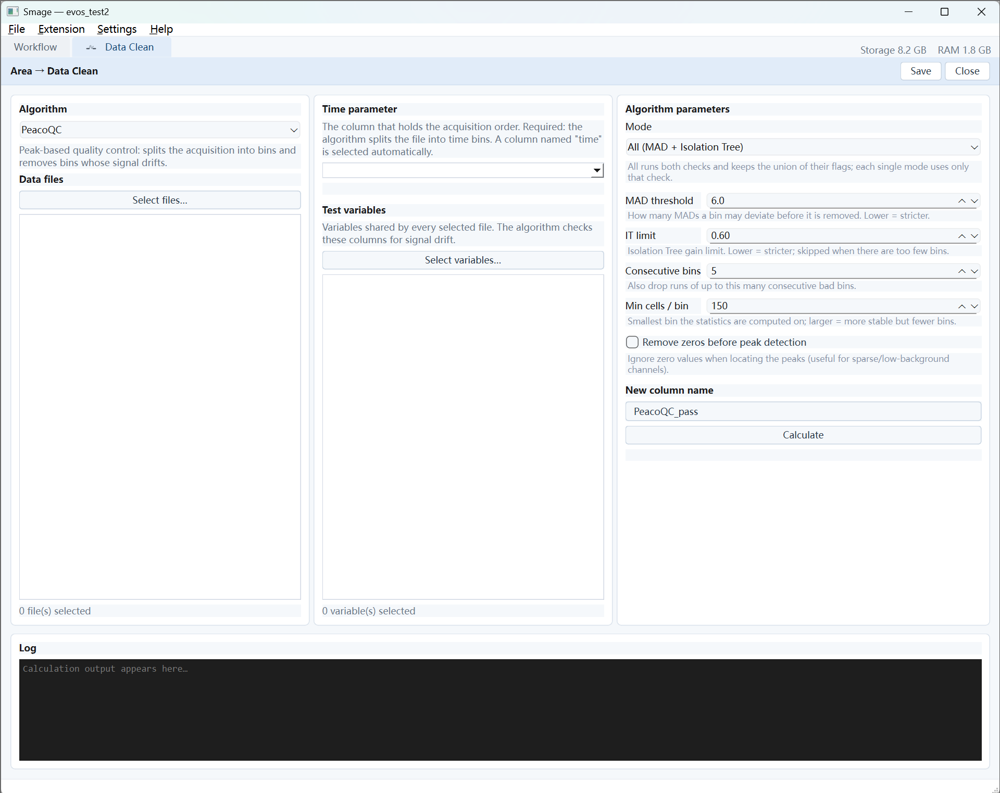

# Data Clean

Flags and removes low-quality events with PeacoQC (the Rust implementation
`peacoqc-rs`), on flow-cytometry time series.

## Settings

| Setting | Description |
|---|---|
| Files | The files to clean. |
| Time column | The acquisition-time column that defines the order of events. |
| Columns | The channels whose behaviour over time is monitored. |
| Mode | `All (MAD + Isolation Tree)`, `MAD only` or `Isolation Tree only`. |
| MAD threshold | How many MADs a bin may deviate before it is removed. Lower is stricter. |
| IT limit | Isolation Tree gain limit. Lower is stricter. |
| Consecutive bins | Also drop runs of up to this many consecutive bad bins. |
| Min cells / bin | Smallest bin the statistics are computed on. Larger is more stable but gives fewer bins. |
| Remove zeros before peak detection | Ignore zero values when locating the peaks. |
| New column name | The name of the resulting column. |

## Output

A per-event column (and the cleaned row set) exposed to downstream modules.

## Notes

- `All` keeps the union of the flags from both checks; the single modes use
  only that check.
- Very small files may have too few bins for the Isolation Tree; use
  `MAD only` in that case.

## Related

[Subsample](subsample.md) · [Gating](gating.md)
