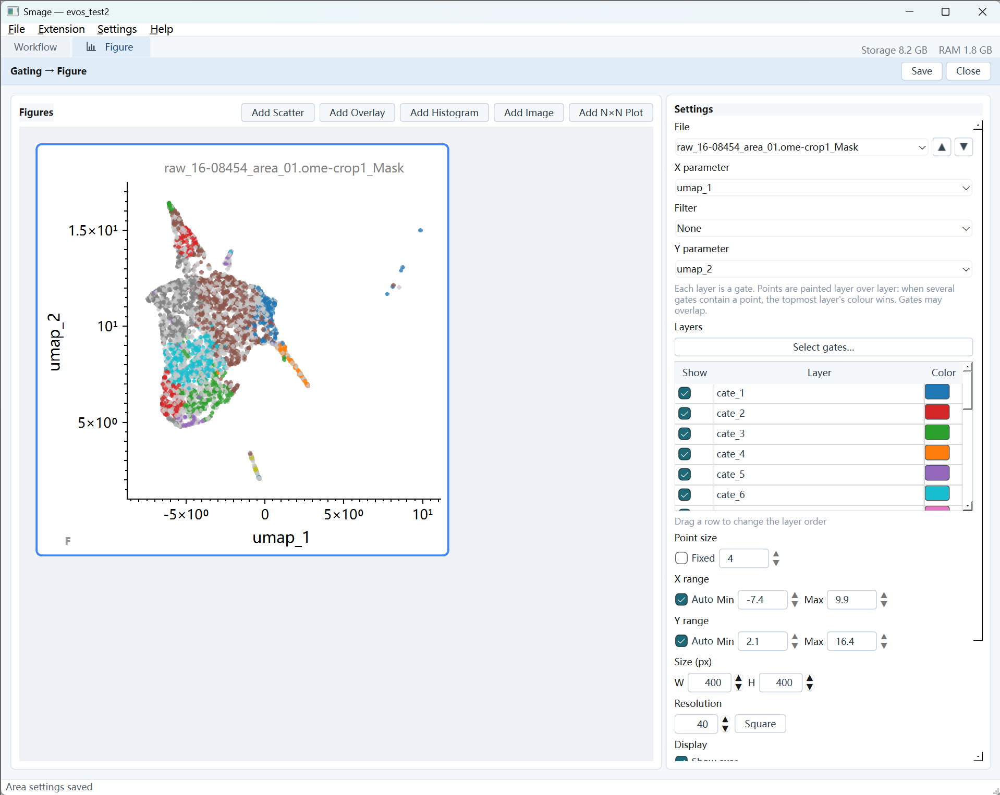

# Dimensionality Reduction

Computes a 2-D embedding (UMAP or t-SNE) that can be used as the axes of a
scatter plot, a gate, or an [Area](area.md) measurement.

## Settings

| Setting | Description |
|---|---|
| Files | The files included in the embedding. |
| Method | UMAP or t-SNE. |
| Backend | `sklearn` (default) or `openTSNE` (experimental) for t-SNE. |
| Channels | The channels used to compute distances. |
| Max events per file | Upper bound on the events used to fit the embedding. |
| PCA components | Dimensionality of the PCA preprocessing step (default 50). |
| New channel names | The two output columns (for example `umap_1`, `umap_2`). |

## Output

Two numeric columns per event (`*_1`, `*_2`) that downstream modules can plot,
gate or measure.

## Notes

- The embedding is fit on a bounded sample for speed; all events are then
  projected with the fitted model.
- Use a [Subsample](subsample.md) module above this one when working with
  millions of events.
- The seed is fixed so the embedding is reproducible.

## Related

[Cluster](cluster.md) · [Gating](gating.md) · [Area](area.md)
