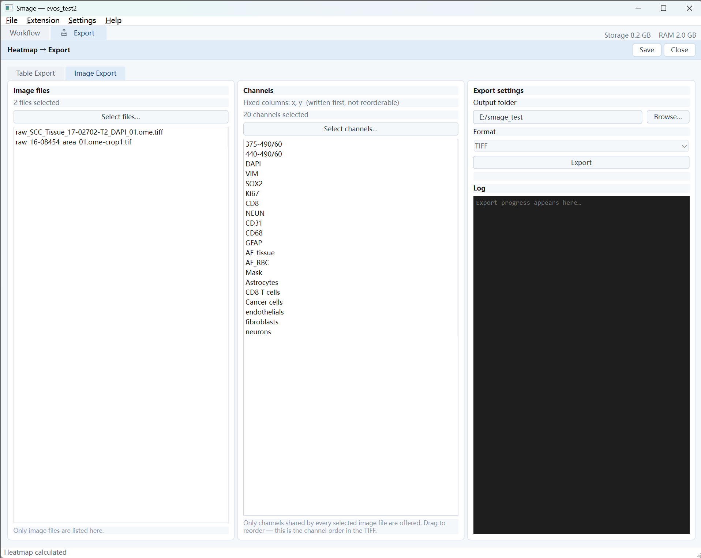

# Export

Writes selected tables and plots to disk.

## Settings

| Setting | Description |
|---|---|
| Data files | The tables to export (imported or generated files). |
| Plots | The figures and heatmaps to export. |
| Output folder | Where the files are written. |
| Format | CSV or Parquet for tables; PNG/SVG/PDF for plots (depending on the source module). |

## Output

One file per selected table/plot in the output folder. The module keeps a log
of what was written and where.

## Notes

- Exported tables contain the pipeline's data values. [Scale](scale.md) is
  display-only and is never applied to exported numbers.
- Gate columns can be added to the exported table with
  [Gate2Col](gate2col.md); per-class values can be added with
  [Feature Up](feature-up.md).

## Related

[Figure](figure.md) · [Heatmap](heatmap.md) · [Gate2Col](gate2col.md)
