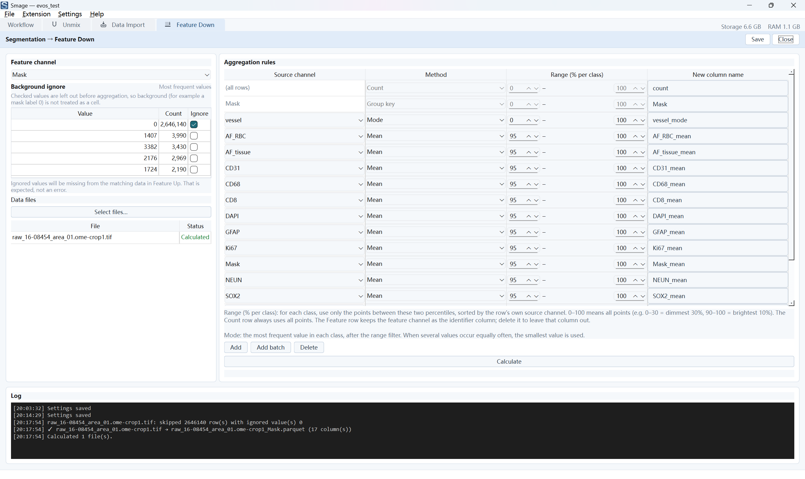

# Feature Down

Aggregates per-cell (or per-event) values into one row per class, producing a
feature table that can be clustered, plotted or exported.



## Settings

| Setting | Description |
|---|---|
| Feature channel | The channel that defines the classes (a segmentation mask label, a sample ID, a cluster column, …). |
| Data files | The files to aggregate. |
| Aggregation rules | One row per output column: **Source channel**, **Method** (count, sum, min, max, mean, median, mode, percentile), **Range (% per class)** and **New column name**. |
| Group-key row | By default a row named after the feature channel is added right below Count. It carries the class label into the output; delete it to leave the identifier column out. |
| Background ignore | Values of the feature channel that are excluded before aggregation (for example the background label `0` of a mask). |

### The Count row

The first row is fixed: it always counts every point in each class and cannot
be deleted or edited. The group-key row below it is a normal, deletable row.

### Add batch

**Add batch** opens the multi-select channel picker. After confirming the
channels, one dialog sets the **Method**, **Range** (and **Percentile** when
that method is chosen) and the **name suffix** for every selected channel.
Each new column is named `<channel>_<suffix>`; an empty suffix uses the
channel name itself, and collisions get `_1`, `_2`, … The dialog previews the
resulting column names.

### Range (% per class)

`0–100` uses every point. `0–30` uses only the dimmest 30 % of each class
(sorted by that row's own source channel); `90–100` the brightest 10 %.

### Mode

**Mode** returns the most frequent value in each class, after the range
filter. If several values occur equally often, the smallest one is used, so
the result is deterministic. Missing values are ignored; a class with no
remaining values gives an empty result.

## Output

One Parquet file per source file, with columns:

```
<feature key>, <count name>, <aggregated column>, …
```

written under `Module/feature-<id>/` and registered as a new data file for
downstream modules.

## Notes

- Default column names are `<source>_<method>` (for example `CD8_mean`);
  rename them in the last column of the rules table.
- The Background ignore section lists the most frequent feature values so the
  background can be excluded with one tick.
- Outputs are re-used until the settings, the source file or an upstream
  sampling change (the module signatures them).

## Related

[Segmentation](segmentation.md) · [Feature Up](feature-up.md) · [Heatmap](heatmap.md)
