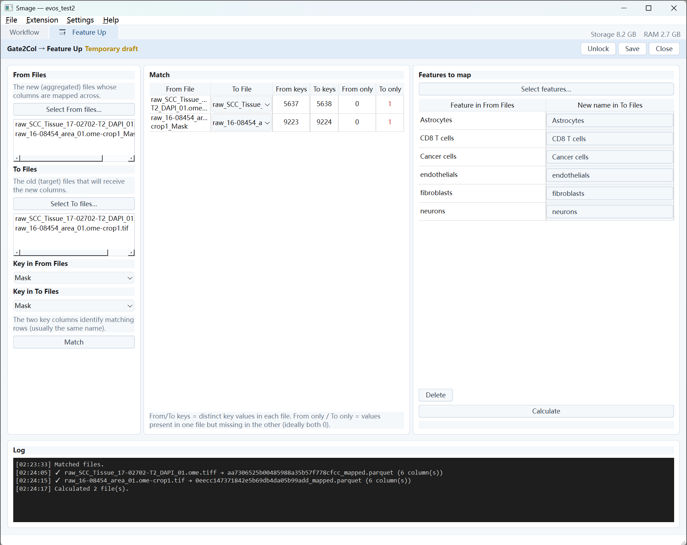

# Feature Up

Maps columns from a **feature table** back onto the original per-event rows,
so that event-level modules (gating, plots, export) can use per-class values.

## Settings

| Setting | Description |
|---|---|
| From Files | The aggregated (feature) files whose channels are mapped across. |
| To Files | The event-level files that receive the new channels. |
| Key in From Files | The column in the feature table that identifies a class. |
| Key in To Files | The column in the target files that matches that key. |
| Match | How keys are matched (exact value, renamed pairs, …). |
| Channels to map | The feature channels that should be copied to the target files. |

## Output

New columns on each **To** file: every event receives the value of its class.
The output is registered as a generated data file for downstream modules.

## Notes

- Typical use: aggregate a marker per cluster with [Feature Down](feature-down.md),
  then map the cluster mean back to every cell for plotting or gating.
- Unmatched keys leave the new column empty; the module warns when this
  happens.

## Related

[Feature Down](feature-down.md) · [Gate2Col](gate2col.md) · [Figure](figure.md)
