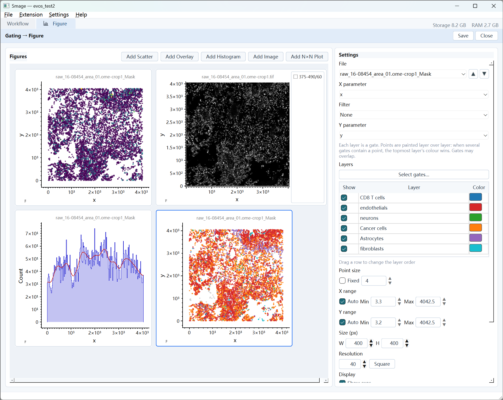

# Figure

Creates publication-style plots from any point of the pipeline: scatter,
histogram and image plots, several per module.

## Settings

| Setting | Description |
|---|---|
| Plot type | Scatter, histogram or image. |
| File | The data file plotted by this figure. |
| Filter | Restrict the plotted events or pixels to an upstream Gating gate. [Regions](region.md) are not filters; once converted they appear as ordinary 0/1 channels in the Channels table. Image plots keep a gate filter on every channel, including unmixed and other generated channels. |
| X/Y range | **Auto** uses the nearest upstream [Scale](scale.md) Min/Max as the default, falling back to the data extent; a manual range is saved and always wins. Overlay plots do not use Scale defaults. |
| X / Y parameter | The axes (Y is hidden for histograms). |
| Color mode | Density, a parameter value, or a solid color. |
| Color parameter / palette / point size | Appearance of the points. |
| Bins / display mode | Histogram binning and how bars are drawn. |
| X / Y range | Axis limits, in original data units. |
| Size (px) / resolution | Output size and DPI of the exported image. |
| Layers (image) | One layer per channel, with its own color, min/max and order. |
| Display toggles | Axes, axis names, tick indices and sample name. |

## Multiple plots

A Figure module can hold several plots; each has its own settings and its own
place in the export. Plots are listed in the module and can be removed
individually.

## Saving a plot

Right-click a plot and choose **Save as…**. The saved file shows the plot
exactly as it currently looks, including the current zoom and pan:

| Format | What is saved |
|---|---|
| PDF | Editable axes, tick labels, titles and image legend; the plot area is a high-resolution bitmap. |
| PNG | A lossless image at three times the screen resolution. |
| JPEG | A compressed image at three times the screen resolution. |

The A/F corner buttons and the cursor readout are not part of the saved
figure.

To write plot data or a whole batch of files, use [Export](export.md).

## Notes

- Display transforms from an upstream [Scale](scale.md) module are applied
  automatically, and range fields are shown in the transformed units.
- Image plots can overlay a gate mask or a segmentation mask.
- Image plots show a cursor readout on a row below the X axis name: pixel
  x/y and the value of every visible layer under the cursor. It reads the
  raster already drawn, so it is instant; zoomed-out values are block means
  and deep-zoom values are exact pixels.

## Related

[Heatmap](heatmap.md) · [Export](export.md) · [Scale](scale.md)
