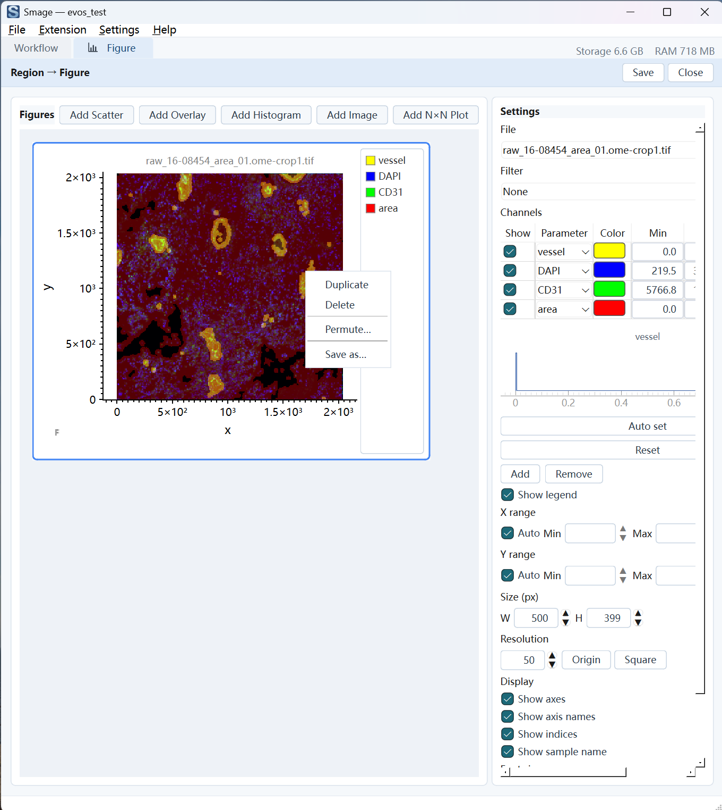

# Figure

Creates publication-style plots from any point of the pipeline: scatter,
histogram and image plots, several per module.

## Settings

| Setting | Description |
|---|---|
| Plot type | Scatter, histogram or image. |
| File | The data file plotted by this figure. |
| Filter | Restrict the plotted events or pixels to an upstream Gating gate. [Regions](region.md) are not filters; once converted they appear as ordinary 0/1 channels in the Channels table. Image plots keep a gate filter on every channel, including unmixed and other generated channels. |
| X/Y range | Each axis has three modes. **Manual** uses the entered Min/Max. **From scale** (default) uses the nearest upstream [Scale](scale.md) that sets **both** Min and Max for that channel; if none does, it switches to **Auto**. **Auto** uses the extent of the drawn data and ignores Scale. The mode applies to scatter, overlay and histogram plots; a histogram's Y axis (counts) offers Manual/Auto only. Image plots keep the Auto checkbox. |
| X / Y parameter | The axes (Y is hidden for histograms). |
| Color mode | Density, a parameter value, or a solid color. |
| Color parameter / palette / point size | Appearance of the points. |
| Bins / display mode | Histogram binning and how bars are drawn. |
| Size (px) / resolution | Output size and DPI of the exported image. |
| Layers (image) | One layer per channel, with its own color, min/max and order. |
| Display toggles | Axes, axis names, tick indices and sample name. |

For **From scale**, a Scale module counts only when it sets both Min and Max
for that channel. When no such module exists, the axis falls back to Auto; it
returns to From scale automatically if the axis is later changed to a channel
with a usable Scale. Explicitly choosing Auto keeps it on Auto.

Range settings are remembered **per channel**: each X/Y channel keeps its own
mode and manual Min/Max, so switching away and back restores them. A channel
seen for the first time starts in From scale. The same applies to the Gating
and Calculation previews.

A multi-plot **Manual** range is entered in original units and converted
through each channel's own Scale transform, so a value such as 0–10000 means
the same thing on a linear, log10 or arcsinh channel.

Every mode leaves a border: the active Min/Max sit at 5 % and 95 % of the
visible axis, so points, bars and curves do not touch the frame. The saved
and displayed Min/Max are unchanged; the margin is applied to the view only.
Histogram count axes follow the same rule, so their bottom edge is slightly
below zero. Image plots keep their exact pixel extent.

## Multiple plots

A Figure module can hold several plots; each has its own settings and its own
place in the export. Plots are listed in the module and can be removed
individually.

## Saving a plot

Right-click a plot and choose **Save as…**. The saved file shows the plot
exactly as it currently looks, including the current zoom and pan:

| Format | What is saved |
|---|---|
| PDF | Editable axes, tick labels, titles and image legend; the plot area is a high-resolution bitmap. |
| PNG | A lossless image at three times the screen resolution. |
| JPEG | A compressed image at three times the screen resolution. |

The A/F corner buttons and the cursor readout are not part of the saved
figure.

To write plot data or a whole batch of files, use [Export](export.md).

## Notes

- Display transforms from an upstream [Scale](scale.md) module are applied
  automatically, and range fields are shown in the transformed units.
- Image plots can overlay a gate mask or a segmentation mask.
- Image plots show a cursor readout on a row below the X axis name: pixel
  x/y and the value of every visible layer under the cursor. It reads the
  raster already drawn, so it is instant; zoomed-out values are block means
  and deep-zoom values are exact pixels.

## Related

[Heatmap](heatmap.md) · [Export](export.md) · [Scale](scale.md)
