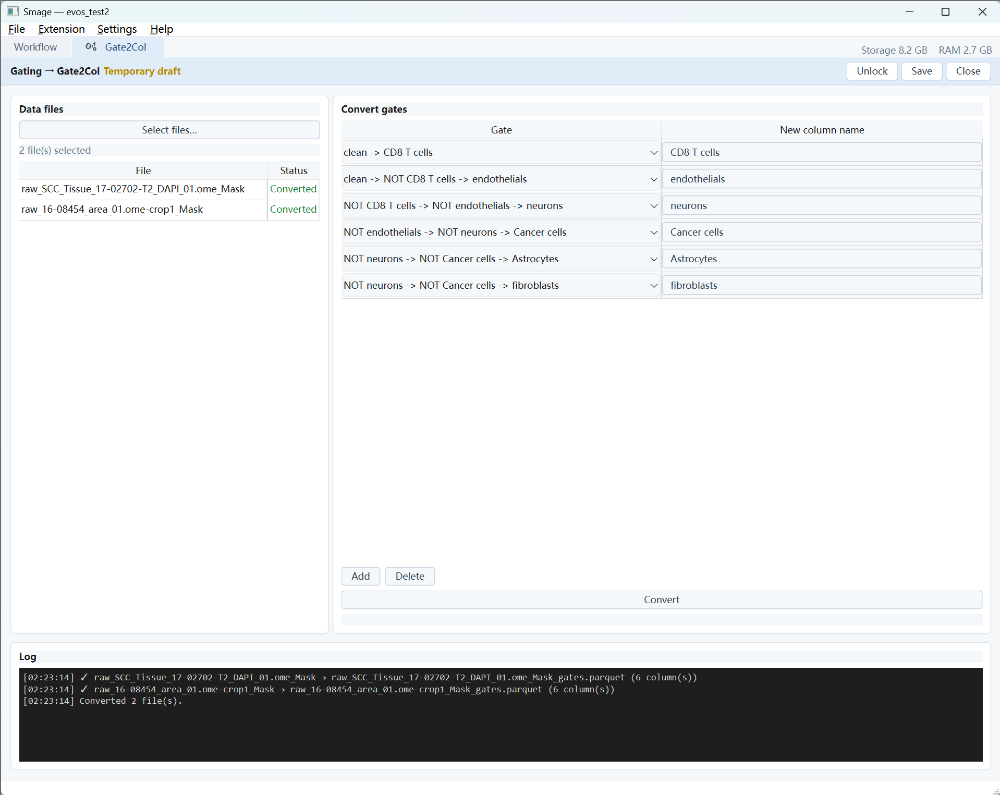

# Gate2Col

Turns gate membership into numeric columns: each gate becomes a column with
`1` for events inside the gate and `0` outside. Useful for exporting gate
labels or using gates as features.

## Settings

| Setting | Description |
|---|---|
| Data files | The files the gates apply to. |
| Convert gates | One row per gate: which gating module it comes from, the gate, and the output column name. |

## Output

A generated data file with one 0/1 column per selected gate, registered for
downstream modules.

## Notes

- Only gates from gating modules **above** this module are offered.
- Boolean gates (NOT/AND/OR) can be converted like any other gate.
- The output columns are ordinary numeric columns: they can be plotted,
  clustered or aggregated with [Feature Down](feature-down.md).

## Related

[Gating](gating.md) · [Feature Down](feature-down.md) · [Export](export.md)
