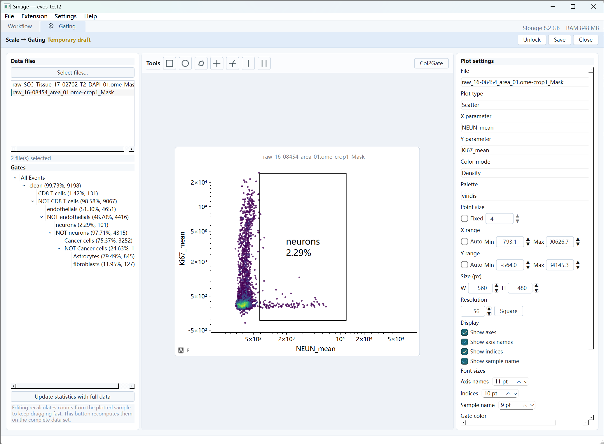

# Gating

Draws gates on scatter, histogram or image plots and reports the number and
percentage of events in each gate.

## Data files

A new Gating module starts empty. Choose **Select files…** to pick the files
the gate tree applies to. The first selected file then opens in the preview,
with its first two channels as the X and Y axes; gate tools stay disabled
until a file is available.

Changing the selection keeps the file currently on screen while it is still
selected. Clearing the selection returns the preview to the empty state; the
gate tree itself is kept.

## Plot settings

| Setting | Description |
|---|---|
| File | The data file to gate. |
| Plot type | Scatter, histogram or image. |

Image plots show the cursor position and the displayed channel values on a
row below the X axis name; the readout hides while a gate is being drawn or
dragged.
| X / Y parameter | The axes of the plot. |
| Color mode | Density, a parameter, or a solid color. |
| Palette / point size | Display options for the points. |
| Gate labels | Show or hide gate names and percentages on the plot. |

## Tools

| Tool | Interaction |
|---|---|
| Rectangle / Ellipse | Drag a box or oval. |
| Polygon | Click vertices; double-click to close. |
| Quadrant | Click to place a crosshair; four quadrant gates are created. |
| Split | Click to place a vertical line; two gates are created. |
| Range | Drag from the low to the high end of a range. |
| NOT / AND / OR | Combine existing gates into a boolean gate. |

Gates form a tree: select a gate and draw again to create children. Each gate
also has a name, color and per-file shape overrides.

## Statistics

- Counts and percentages are computed in the background.
- While you edit, they are computed on the **displayed sample** (fast);
  releasing the mouse refreshes them.
- **Update statistics with full data** recomputes every gate on all rows.
- Moving a gate also refreshes boolean gates that reference it and their
  children.

## Outputs

- The gate tree (stored in `Module/gating-<id>/gates.json`).
- Gate membership is available to [Figure](figure.md), [Gate2Col](gate2col.md)
  and [Export](export.md) as filters or columns.

## Notes

- Gates are stored in original data units; a [Scale](scale.md) module above
  only changes how they are drawn.
- Double-clicking a gate opens its subset view, which draws only the gates
  created inside it. The gates that make up a **NOT / AND / OR** gate belong
  to the level above the subset, so opening a boolean gate shows its subset
  without those outlines.
- An ellipse drawn on a log or arcsinh axis is stored as a sampled outline of
  that ellipse, so the selected events are exactly the ones inside the shape
  you drew. (A mathematical ellipse in data units would not match the drawn
  shape on a non-linear axis.)
- The gate tree is saved with **Save**; closing with unsaved changes asks for
  confirmation.

## Related

[Gate2Col](gate2col.md) · [Figure](figure.md) · [Scale](scale.md)
