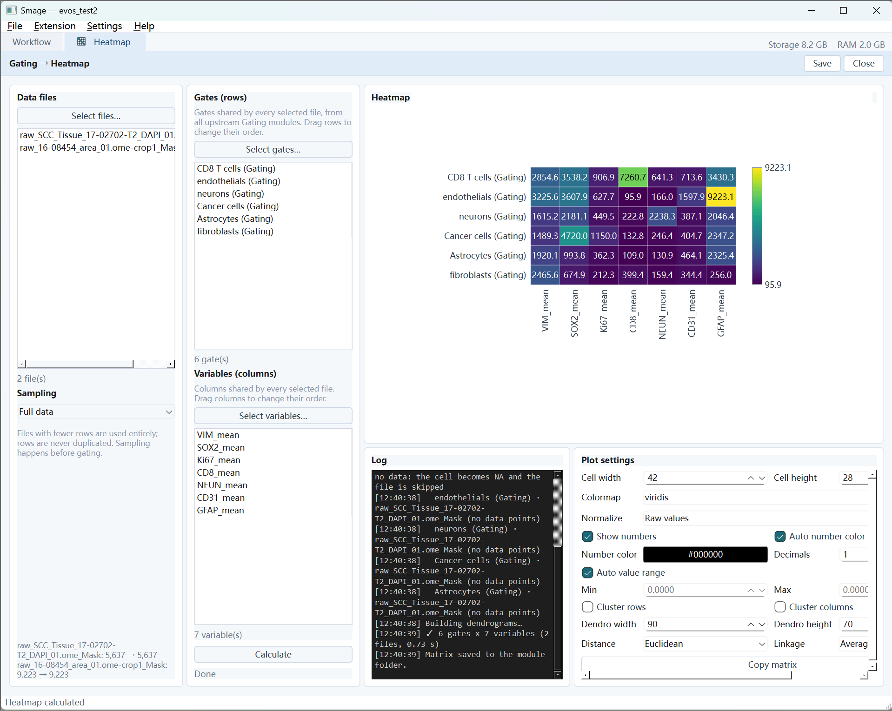

# Heatmap

Shows a matrix of feature values (for example the mean marker intensity per
cluster) with optional row/column clustering and a dendrogram.

## Settings

| Setting | Description |
|---|---|
| Sampling | For large files: `Uniform per file` or `Proportional`, with a rows-per-file limit. Sampling happens before gating. |
| Cell width / height | Size of each matrix cell. |
| Colormap | Color scale for the values. |
| Normalize | Scale values per row, per column or globally. |
| Legend title | Title drawn beside the color scale. It follows Normalize (`Raw value`, `Row z-score`, `Column z-score`) until you edit it; clear the box to hide the title. |
| Number color / decimals | Show the numeric value in each cell. |
| Min / Max | Color range. |
| Distance / linkage | Metric and linkage used for clustering. |
| Dendro width / height | Size of the row/column dendrograms. |

## Output

A live heatmap view; export it through [Export](export.md) or the module's own
export action.

## Notes

- A new Heatmap module starts with **no data files selected**: choose the
  files with **Select files…**, then the gates (rows) and channels (columns)
  that exist in all of them.
- Gate (row) names stay short. When two upstream modules contain a gate with
  the same name, both rows show the module name in brackets to tell them
  apart; unique names are shown as they are.
- Right-click the heatmap and choose **Save as…** to write it as it is
  currently shown. **PDF** keeps the cells, grid, dendrograms, color scale
  and every label as vector shapes and editable text; **PNG** and **JPEG**
  are written at three times the screen resolution.
- The heatmap reads the feature table produced by
  [Feature Down](feature-down.md) (or any table with a class column).
- Clustering is computed on the aggregated matrix, not on the event table, so
  it stays fast even for large experiments.

## Related

[Feature Down](feature-down.md) · [Figure](figure.md) · [Export](export.md)
