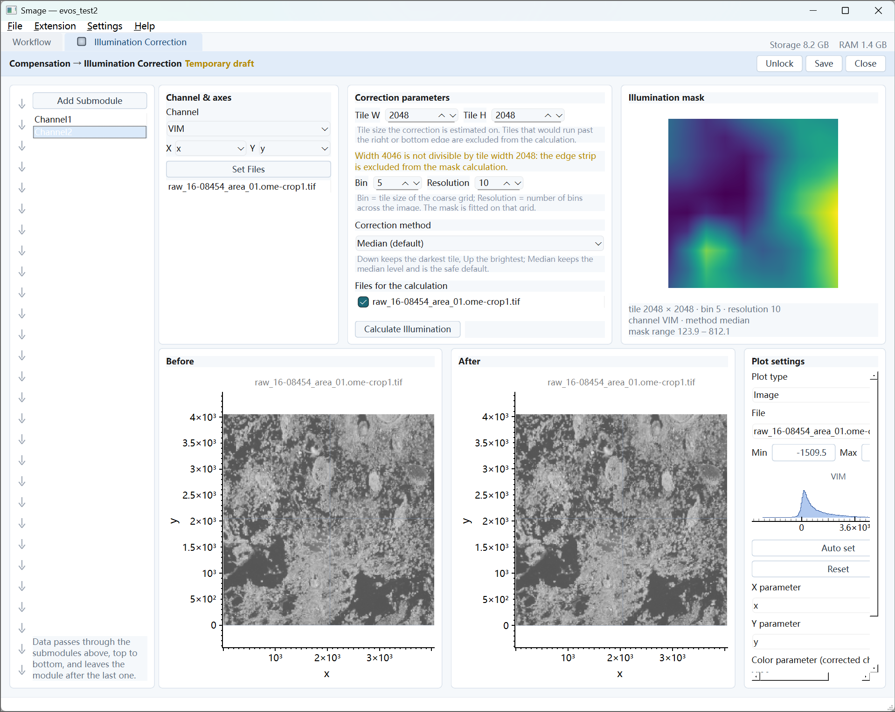

# Illumination Correction

Corrects uneven illumination across an image by tiling the field of view,
estimating a per-tile brightness profile and dividing it out.



## Settings

The panel is split into **Tiles calculation** and **Correction parameters**.

| Setting | Description |
|---|---|
| Channel | The channel to correct. |
| Shift | Constant added to the channel before recognition and preview, and removed again in the data passed downstream. Default 0. |
| Tile W / Tile H | Size of the tiles the image is divided into. |
| Bin | Binning used when building the brightness profile. |
| Resolution | Resolution of the estimated correction map. |
| Files for illumination pattern recognition | Which files contribute to the estimate. |
| Correction method | How tile factors are combined into the correction map. |
| Correction intensity | Strength of the correction; 0 = none, 1 = full (default), 2 = double. Negative values invert the correction. |
| Pattern floor | Minimum the pattern is raised to when it contains negative values (default 100). |

**Tiles calculation** recognizes the illumination pattern. **Correction
parameters** apply it: the method picks the reference level (darkest,
brightest or median tile) and the intensity blends the resulting factor
linearly:

```
factor = T / mask
factor = 1 + intensity × (factor − 1)
```

A negative **Correction intensity** inverts the correction: the factor is
mirrored around 1, so regions the pattern would brighten are darkened and
vice versa.

Edits to the correction method or intensity are applied with the **Update**
button; the line below it shows the method and intensity currently in use.
Downstream channels use the saved settings, so they change only after the
module is saved.

**Auto set** estimates the tile size and background threshold from the data.
The preview plot shows the corrected channel, with its own display range and
palette. In **Plot settings**, the image levels (Min/Max, Auto set, Reset) are
shared by both previews; the **Before** histogram above them is read-only and
shows the uncorrected distribution. When Min/Max are set, both histograms are
limited to that window, so the visible distribution matches the image levels.
Zooming or panning re-samples the image at the current magnification, so
detail stays sharp when zoomed in. The button below the previews copies the
zoom and position of the preview under the pointer to the other one; its
arrow (**Sync view →** or **Sync view ←**) shows the direction that will be
used.

The channel can be an imported channel, a channel produced by an upstream map
module, or a generated **Unmix** channel. The tile calculation reads a
generated channel from its saved output. The tile width and height must fit
inside the image: an image smaller than one tile produces no data to estimate
the pattern from, and the panel shows a hint in that case.

**Recognize Illumination Pattern** reads a two-dimensional sample of each
selected file (up to about two million pixels) instead of loading it whole,
so large files are processed in seconds with bounded memory. The sample is
stratified on the estimator's own blocks — the tile divided by the bin count
— with a per-tile phase offset, so every block of every tile is covered in
both x and y. A banded or single-stride sample would leave some blocks empty
and show up as stripes in the mask. The progress line next to the button
shows the current file, and the button turns into **Cancel** while the
calculation runs; cancelling keeps the previous pattern. Each file's time is
recorded in the run log.

The **Before** and **After** image previews always share one display range, so
a change of correction method, intensity or pattern is visible instead of
being normalized away by two independent automatic ranges. The range comes
from the sampled signal distributions; the Min/Max fields override it.

A pattern estimated from a background-subtracted channel can contain negative
values, where the reference level divided by the local brightness is
meaningless. When the pattern has negative values it is raised so its lowest
value equals **Pattern floor**; every cell then takes part in the correction.
The floor is applied by **Update**, together with the method and intensity.

**Shift** adds a constant to the channel at the submodule's input: the tile
statistics, the Before preview and the correction all work on the shifted
values, and the data passed downstream has the shift removed again. Raising a
background-subtracted channel above zero this way keeps its negative
background from being amplified by the multiplicative correction; the
downstream level of the background is preserved. The previews and their
histograms show the shifted values, so they differ from downstream data by
the shift. Changing the shift clears the pattern, because it was estimated in
the previous shifted domain.

**Paste illumination pattern** replaces the pattern with a matrix from the
clipboard. The matrix must have exactly `tile height × tile width` values,
one row per line (tab, comma or space separated). **Copy pattern** (in the
Illumination pattern panel) writes the current pattern as a tab-separated
matrix with full precision, so it can be pasted back or into another module.
A pasted pattern is labelled as such next to the buttons and in the pattern
panel; changing the tile size clears it, while the bin and resolution only
affect the recognized pattern.

The preview keeps the uncorrected pixels it last read for the current view.
Changing the correction parameters with **Update**, or re-recognizing the
pattern, re-applies the correction to those pixels instead of reading the
file again, so it is instant even on multi-gigabyte images. Reading is only
needed when the file, channel or zoom changes; zooming redraws just the plot
being zoomed.

## Output

Corrected values for the selected channel. Downstream modules see the
corrected channel; the raw data is unchanged.

## Notes

- The correction map is estimated once per channel and cached; changing a
  downstream module does not re-estimate it.
- The signal histograms in **Plot settings** are read in the background from
  a sample of the channel, so switching file, channel or parameters never
  blocks the window. **Auto set** and **Reset** use the same sample.
- The illumination pattern used for estimation is persisted under
  `Module/illumination-<id>/` inside the project.
- Duplicating a submodule also copies its recognized illumination pattern
  (and how it was computed), so the copy starts from the same profile.
- Correction method and intensity edits apply to the preview when **Update**
  is clicked; the downstream channel changes when the module is saved.
  Unsaved edits are discarded when the module is closed.

## Related

[Unmix](unmix.md) · [Segmentation](segmentation.md) · [Scale](scale.md)
