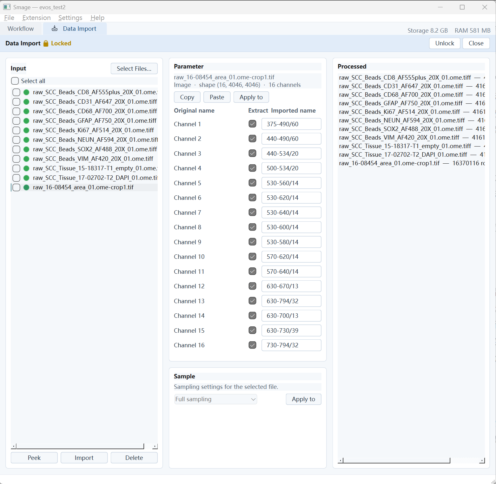

# Data Import

Turns raw files into the project's normalized table. Every downstream module
reads this table (or files generated from it).

## Supported input

- **Flow cytometry** — `.fcs` files.
- **Images** — TIFF / OME-TIFF stacks; each channel becomes a column and each
  pixel (or segmented object) a row.
- **Tables** — delimited text files (CSV/TSV).

## Settings

| Setting | Description |
|---|---|
| Files | The files to import. Each file is imported once and listed under `data/`. |
| Original name / Imported name | The column name in the source file and the name it gets inside the project. |
| Extract | Tick the columns that should be kept. Unticked columns are not written. |
| Sampling | Optional per-file down-sampling applied while importing (for very large files). |
| Apply to all files | Copies the current parameter settings to every selected file. |

## Output

One normalized Parquet file per imported file in `<project>.smage/data/`,
registered in `data/columns.json`. Downstream modules can select these files.

## Notes

- Renaming a column here changes its name for the whole project; use
  [Rename](rename.md) if you only want to change names for a branch of the
  workflow.
- Image channels are stored as numeric columns (pixel intensities); image
  coordinates are kept as `x` and `y`.

## Related

[Rename](rename.md) · [Subset](subset.md) · [Segmentation](segmentation.md)
