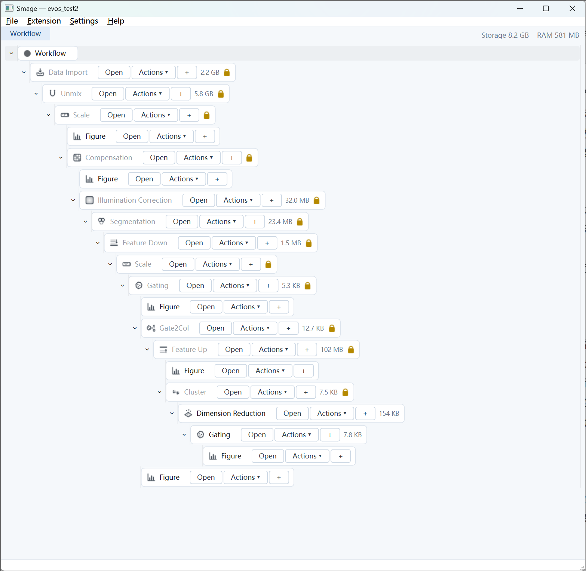

# Modules overview

Every analysis step in Smage is a **module** in the workflow tree. Modules are
chained: each one sees the data produced by the modules above it, applies its
own settings, and passes the result down.

## How modules behave

- **Save vs Run.** Changing settings marks a module as modified. Downstream
  modules only see the *saved* state, so press **Save** after editing.
  Modules that produce data (Import, Segmentation, Feature Down, Feature Up,
  Gate2Col) also have a **Run/Calculate** action that writes their output.
- **Locking.** A module that has saved output locks; upstream modules cannot
  be changed until the output is removed or the module is unlocked. Smage
  shows a lock badge in the workflow tree.
- **Generated files.** Only some modules write files: Data Import writes the
  normalized table, Segmentation writes masks, Unmix writes unmixed columns
  for tables and unmixed image channels, Region writes converted 0/1 channels,
  and Feature Down/Up and Gate2Col write new tables. Other modules compute on
  demand and are always up to date with the saved settings above them.
- **Display-only steps.** The Scale module never changes values — it only
  changes how they are drawn.

## Reference

| Group | Module | What it does |
|---|---|---|
| Input | [Data Import](import.md) | Normalize FCS, image and tabular files into the project table |
| Input | [Rename](rename.md) | Rename columns or files for downstream modules |
| Input | [Subsample](subsample.md) | Keep a fixed random number of events per file |
| Input | [Subset](subset.md) | Restrict which files and columns downstream modules see |
| Map values | [Compensation](compensation.md) | Apply a spillover matrix to flow-cytometry channels |
| Map values | [Illumination Correction](illumination.md) | Correct uneven illumination per channel |
| Map values | [Batch Align](batch-align.md) | Align batches with CytoNorm (reference-based) or ComBat (reference-free) |
| Map values | [Calculation](calculation.md) | Build new channels with Clip, Scale, Add or a custom contrast curve |
| Display | [Scale](scale.md) | log10 / arcsinh / linear display transform |
| Gating | [Gating](gating.md) | Create gates and per-gate statistics |
| Image | [Segmentation](segmentation.md) | Cellpose, StarDist or threshold masks |
| Image | [Region](region.md) | Detect Regions and expose them downstream as 0/1 image channels |
| Analyse | [Region Size](region-size.md) | Pixel area of each Region in each image file |
| Generate | [Unmix — Spectrum Extraction](unmix.md) | Build reference spectra from single stains |
| Generate | [Unmix — Matrix Unmixing](unmix-matrix.md) | Signatures, similarity and generated unmixed channels |
| Features | [Feature Down](feature-down.md) | Aggregate values per class into a feature table |
| Features | [Feature Up](feature-up.md) | Map feature-table columns back to events |
| Features | [Gate2Col](gate2col.md) | Turn gate membership into 0/1 columns |
| Compute | [Cluster](cluster.md) | K-means, FlowSOM, PhenoGraph, Leiden, DBSCAN, Hierarchical, PARC |
| Compute | [Dimensionality Reduction](dimred.md) | UMAP or t-SNE embeddings |
| Compute | [Data Clean](data-clean.md) | PeacoQC quality control |
| Output | [Figure](figure.md) | Scatter, histogram and image plots |
| Output | [Heatmap](heatmap.md) | Clustered heatmap of feature values |
| Output | [Export](export.md) | Write tables and plots to disk |
