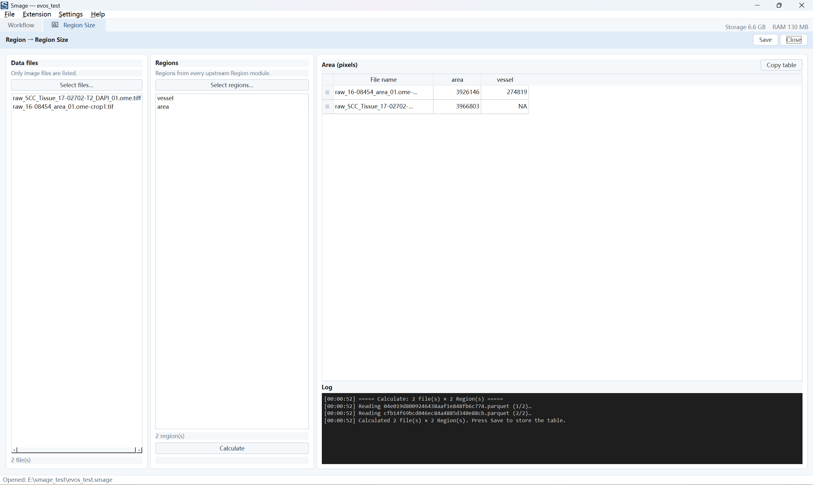

# Region Size

Calculates the **pixel area of every Region** in every selected image file.
It replaces the old Area module and produces a report table only; it does not
change the data that flows downstream.

## Inputs

| Side | Contents |
|---|---|
| Left | Image files. |
| Middle | Converted, downstream-visible Region channels from every upstream [Region](region.md) module; **Calculate** at the bottom. |
| Right | The file × Region area table. |

Only Regions that were converted to a channel and ticked **Downstream
visible** are listed. An unconverted Region, or one whose visibility is off,
does not appear. Regions from several upstream Region modules can be
combined. If two selected Regions share a name, the column label is prefixed
with the module name (`Module/Region`).

A new Region Size module starts with **no image files and no Regions
selected**. Use **Select files…** and **Select regions…** to choose them
before pressing **Calculate**.

The right-hand **Area** panel is split into the table (top) and a log
(bottom); drag the divider to change the 4:1 default. The log reports each
file while Calculate runs.

## Results

- One row per selected file, one column per selected Region channel.
- The value is the number of pixels with mask value **1** in the Region's
  converted channel. The mask is produced when the Region is converted, so
  the table reflects the mask and not an on-the-fly polygon test.
- A file **without** a converted mask for that Region shows **NA** (not 0).
  This includes files on which the Region has no Sample.
- A Sample with **no sub-regions** was converted to an all-zero mask and
  shows **0**.
- Region Size no longer reads pixel coordinates; the mask's stored inside
  pixel count is used, so large files calculate quickly.

The table is sorted by file name and Region name by default. Drag the row
handle or a Region column header to change the order.

**Copy table** copies the current visual order with a `File name` first
header, ready to paste into Excel.

## Calculate, Save and locking

Press **Calculate** to run the area calculation in the background. The log
below the table reports progress file by file and is kept with the module;
another Calculate appends to it instead of clearing it.

The calculated table is **pending**: it is shown in the window but not yet
stored. Press **Save** to write it with the module and lock the upstream
modules. Closing the page with an unsaved table asks for confirmation first.

The table and column labels update on Calculate; changing the file or Region
selection keeps the previous table visible with a hint until Calculate is
pressed again. A Region Size module has no automatic result removal: delete
the module, or unlock the upstream modules for the session, to change inputs
after saving.
