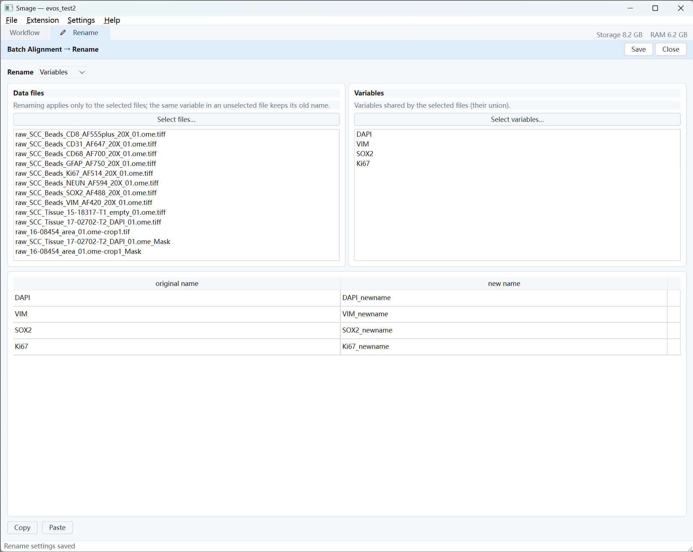

# Rename

Renames columns (or files) so that downstream modules see friendlier names —
for example mapping `FL1-A` to `CD3` — without changing the imported data.

## Settings

| Setting | Description |
|---|---|
| Mode | Rename **columns** (a pipeline name transform) or rename **files** (display names only). |
| Files | The files the rename applies to. |
| Mapping | Old name → new name, one row per rename. |

## Output

- **Column mode** participates in the data pipeline: modules below see the
  new names, and saved outputs of modules above remain valid.
- **File mode** only changes the display name in file lists and plots.

## Notes

- A rename that would collide with an existing column name is flagged; the
  renamed column wins.
- Column renames apply only to the files selected in this module.

## Related

[Data Import](import.md) · [Subset](subset.md)
