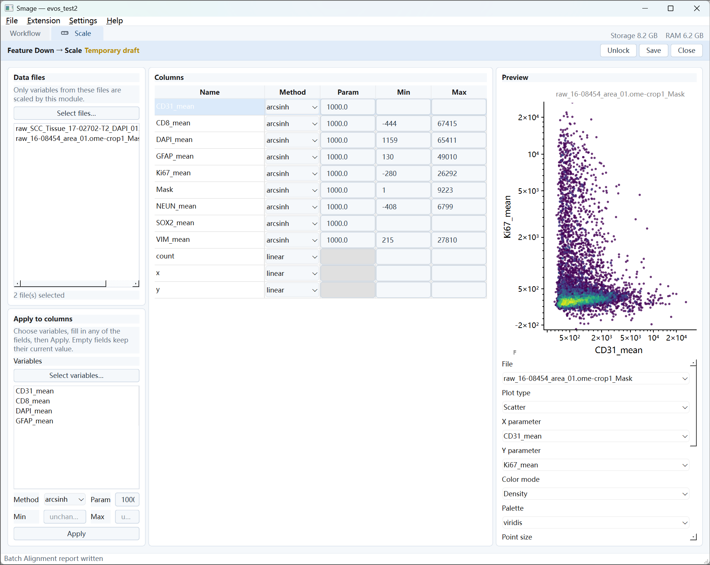

# Scale

Applies a **display-only** transform (log10, arcsinh or linear) to selected
variables. Values are never changed in the data — only the way they are drawn
in plots and the coordinates used for gate shapes on screen.

## Settings

| Setting | Description |
|---|---|
| Variables | One row per transformed column. |
| Method | `linear`, `log10` or `arcsinh`. |
| Param | The cofactor for `arcsinh` (ignored for the other methods). |
| Min / Max | Optional display range in original units. |

## Behaviour

- Plots below the module are drawn in transformed coordinates, with axis
  labels converted back to original values.
- Gates are stored in **original data units**, so moving a scale module or
  changing its settings never invalidates gates or statistics.
- The data pipeline (compensation, unmixing, gating, export) ignores Scale
  entirely.

## Notes

- A linear configuration leaves the axis untouched (pyqtgraph's own ticks are
  used).
- The preview in the module uses the same transform as the rest of the
  application, so what you see is what downstream plots will show.

## Related

[Gating](gating.md) · [Figure](figure.md)
