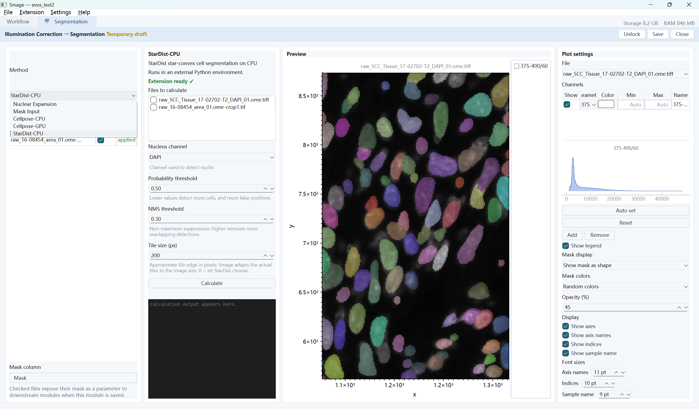

# Segmentation

Segments nuclei (and optionally whole cells) from an image channel and writes
a mask column that downstream modules can use as the feature variable.

## Methods

| Method | Runs where | Description |
|---|---|---|
| Threshold | Inside Smage | Classical thresholding with size filtering and optional expansion. |
| Cellpose | External Python environment | Learned segmentation; installed from the Extension Manager. |
| StarDist | External Python environment | Star-convex nucleus segmentation; installed from the Extension Manager. |

## Settings

| Setting | Description |
|---|---|
| Method | Threshold, Cellpose or StarDist. |
| Nucleus channel | The image channel that contains the nuclei. |
| Threshold | Intensity threshold for the classical method. |
| Minimum nucleus area (px) | Smaller objects are discarded. |
| Expansion radius (px) | Grows each nucleus into the surrounding cytoplasm. |
| Mask column | Name of the column that receives the object labels. |
| Files to calculate | The image files to segment. |

The preview shows the mask over the image with configurable mask display,
colors and opacity.

## Output

One mask per file, written under `Module/segmentation-<id>/` and exposed to
downstream modules as a label column (each object has a unique integer).

## Notes

- The mask column is a valid **feature variable** for
  [Feature Down](feature-down.md) and can be used for gating, plotting and
  export.
- Cellpose and StarDist run in the separate environment created by the
  Extension Manager; their models are downloaded on first use.
- Recalculating replaces the saved masks for the selected files.

## Related

[Feature Down](feature-down.md) · [Area](area.md) · [Figure](figure.md)
