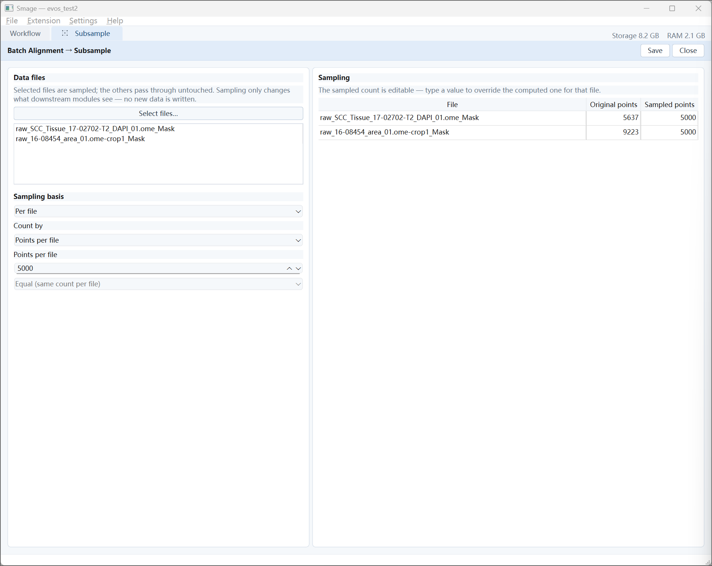

# Subsample

Keeps a fixed random number of events per file for everything downstream —
useful when a file has millions of events and only a sample is needed for
clustering, embedding or plotting. Sampling can be restricted to one or more
gate populations.

## Settings

| Setting | Description |
|---|---|
| Files | The files to sample. |
| Filter | Gates to sample inside. Only gates available for every selected file are listed; multiple gates are combined with OR. |
| Sampling method | Whether the target is per file or a total across files. |
| Count by | Whether the target is a number of points or a percentage of the in-gate points. |
| Points per file | Target number of events (or percentage). |
| Allocation | How the total is distributed across files (equal, proportional to in-gate size, …). |

## Output

A row subset. Downstream modules see only the sampled rows; when sampling
inside a gate filter, rows outside the selected gates are hidden as well.
Unsampled rows are reported as *not evaluated* (NaN) where a full-length
column is required.

## Notes

- A gate filter is active once a **Sampling method** is chosen. It then
  contains the gate and all its ancestors, so a child gate keeps its parent's
  condition.
- The **In gates** column shows how many points each file has inside the
  selected gates. Percentages, the Total allocation and manual count edits all
  use this number, not the full file size.
- Gates edited after saving this module invalidate the sampling masks; the
  module shows the new counts when reopened and should be saved again.
- The sample is deterministic for a given file and target size, so re-running
  an analysis reproduces the same rows.
- Plotting and gate statistics operate on the sampled rows, which keeps
  interactive work fast.

## Related

[Subset](subset.md) · [Cluster](cluster.md) · [Dimensionality Reduction](dimred.md)
