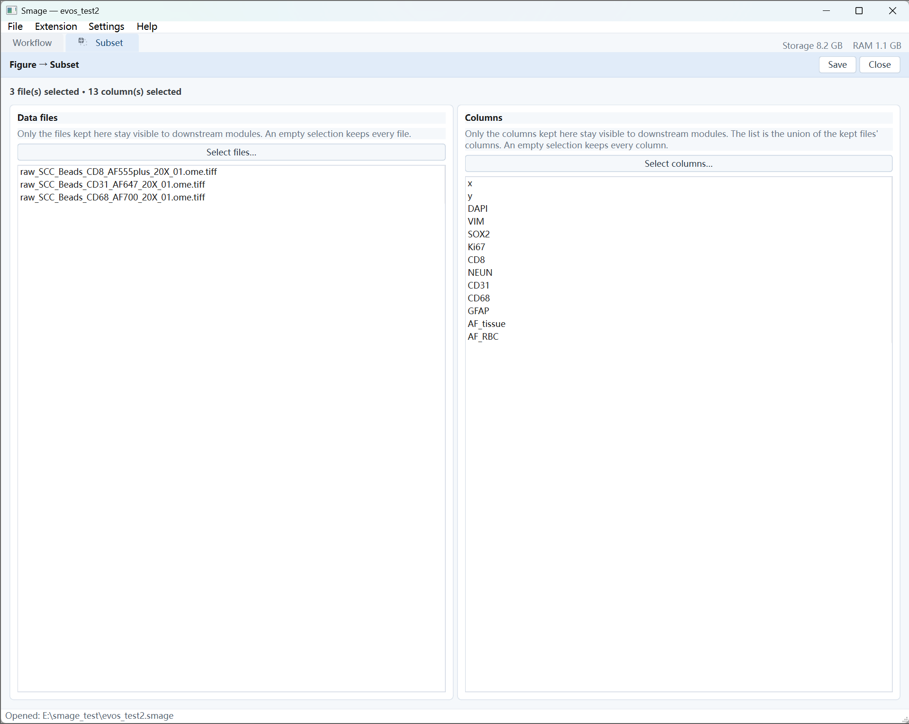

# Subset

Restricts which **files** and **columns** downstream modules can see. It does
not remove rows.

## Settings

| Setting | Description |
|---|---|
| Data files | The files that stay visible below this module. An empty selection keeps every file. |
| Columns | The columns that stay visible below this module. The list is the union of the kept files' columns. An empty selection keeps every column. |

## Output

A filtered view of the pipeline. Modules below only offer the kept files and
columns; generated outputs above remain untouched.

## Notes

- Use Subset to keep a branch of the workflow focused (for example only the
  markers a clustering step needs) without deleting data.
- The Subset module is a view, not a copy: no new Parquet file is written.

## Related

[Data Import](import.md) · [Rename](rename.md) · [Subsample](subsample.md)
