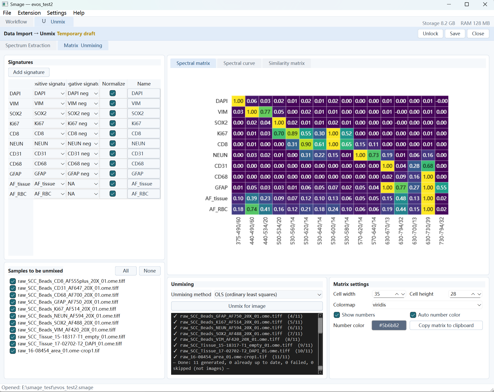

# Unmix — Matrix Unmixing

The second tab of the [Unmix](unmix.md) module: it turns spectra into
signatures, checks how separable they are, and generates unmixed channels for
the selected table and image files.



## Signatures

The **Signature source** at the top of the panel chooses where the matrix
comes from. Both sets of data are kept when you switch, so nothing has to be
rebuilt.

### From spectra (default)

| Column | Description |
|---|---|
| Positive spectrum | The spectrum of the fluorophore, taken from its single-stain control. |
| Negative spectrum | The spectrum of the negative control, subtracted as autofluorescence. |
| Normalize | Normalise the signature to its maximum (on by default). |
| Name | The fluorophore name; this becomes the output channel name. |

**Add signature** appends a row. The list should contain one signature per
fluorophore plus any autofluorescence signatures (`AF_tissue`, `AF_RBC`).

### Manual input

Choose **Manual input** to use a matrix that was built elsewhere. **Paste
matrix** reads the clipboard; the expected text is exactly what **Copy
matrix** writes:

```text
Signature	CD3	CD8	CD45
Signature 1	1.0	0.4	0.2
AF_tissue	0.1	0.9	0.3
```

The first header cell must be `Signature`. The channel set must match the
channels selected in **Spectrum Extraction**; a different order is accepted
and kept as pasted. Rows with a missing name, duplicate names, a wrong column
count, an empty cell or a non-numeric value are rejected with a message and
the current matrix is left untouched.

Every pasted cell can be edited, and the rows can be dragged into a new order
by their header. Columns start compact (the Signature column is 20 characters
wide, value columns 5) and any divider can be dragged to widen them; long
channel names are elided until you do.

If the channel selection changes after pasting, the matrix is kept but marked
with a warning, and **Run unmix** refuses to run until the paste matches
the selection again (a channel reorder is fine).

**Copy matrix to clipboard** writes each value with 17 significant digits,
enough to round-trip a float64 exactly. Copy → paste therefore reproduces the
matrix values exactly, subject to the same channel selection.

## Matrix views

| Tab | Shows |
|---|---|
| Signature matrix | Signature × parameter matrix as a heatmap with the values in each cell. |
| Signature curves | The signatures drawn as curves across the parameters. |
| Similarity matrix | Cosine similarity between signatures, fixed to the −1…1 scale. |

The similarity matrix is the quickest check: two very similar fluorophores
(bright cells in the off-diagonal) are hard to unmix and may need a different
panel or gating.

Right-click a matrix heatmap and choose **Save as…** to write it as it is
currently shown (zoom included). **PDF** keeps the cells, numbers and names
as vector shapes and editable text; **PNG/JPEG** are written at three times
the screen resolution. Right-clicking the **Signature curves** plot offers
the same formats; its PDF keeps the axes and text editable, and the
signature legend above the plot is included in the export.

**Similarity settings** control the rendering: cell width/height, colormap,
show numbers, auto number colour, number colour, and **Copy similarity to
clipboard**.

## Samples to be unmixed

Click **Select files…** to choose the table and image files that should be
unmixed in the shared multi-select dialog. Only these files get unmixed
channels downstream.
If a file that was already unmixed is removed from the selection, the next
**Run unmix** asks before deleting its saved output and removing those
channels from downstream modules.

## Channel data type

The **Unmixing** panel has a **Channel data type** setting for generated
outputs:

- **Keep type (float if negative)** (default): keep the source dtype when
  the rounded result has no negatives. If a file has negative rounded values,
  use the smallest float dtype that covers its range (`float16`, `float32` or
  `float64`).
- **Keep data type**: always use the source channel dtype. For integer
  sources, decimals are rounded, negatives become zero and values above the
  dtype maximum are clipped. Float sources keep their dtype and values.
- **Adapt to results**: choose the smallest dtype per file by byte width.
  Integer results use the smallest fitting integer type; fractional or
  non-finite results use the smallest fitting float type.

Image `x` and `y` columns keep the source integer dtype. Modes that decide
the dtype from the results (`Keep type (float if negative)` on integer
sources and `Adapt to results`) first scan the values without writing, then
write the final dtype directly, so no full-size temporary copy is created and
the output is never read back.

## Running

1. Choose the **Unmixing method** (`OLS` — ordinary least squares — is the
   default).
2. Press **Run unmix**. The status bar shows the current file and percentage;
   the log shows each file with its size, output dtype and elapsed time, and
   a summary (`generated`, `already up to date`, `failed`, `removed`).
3. **Cancel** stops the run after the current chunk; the partial output of
   the file being written is removed.
4. **Run unmix** saves the generated outputs automatically. **Save** without
   running stores only the module settings; downstream modules do not see
   unmixed channels until the module is run.

Table files produce a companion parquet containing only the unmixed columns,
row-aligned to the source. Image files produce `x`, `y` and the unmixed
columns plus an image pyramid.

## Notes

- A signature with an empty positive spectrum is ignored; the log warns when
  a file has no usable source data.
- Unmix is a generate module: without a saved output there are no unmixed
  channels for downstream modules. Opening an older project therefore
  requires **Run unmix** once.
- Unmixed outputs are cached per file; changing a signature, the source file,
  or an upstream map module (Compensation, Unmix, Illumination, Batch Align,
  Rename, Calculation) invalidates the affected outputs.
- Image and table outputs use the same least-squares solution and upstream map
  stages.
- The unmixed channels are ordinary columns, so they can be plotted, gated,
  segmented or aggregated like any other channel.
