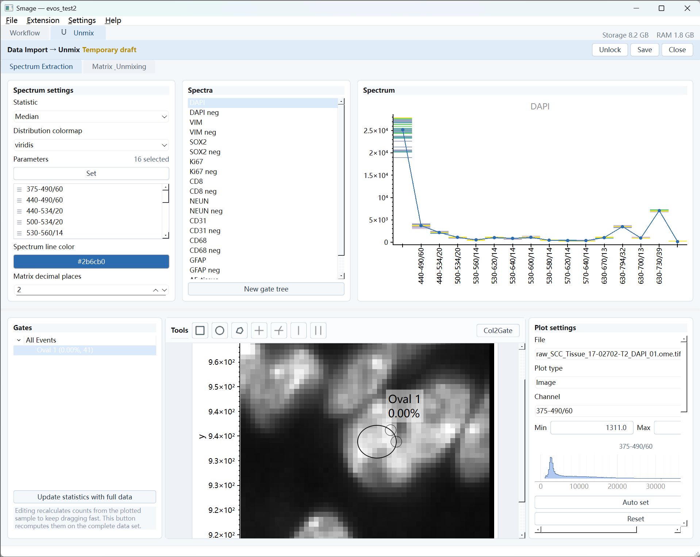

# Unmix — Spectrum Extraction

Separates overlapping fluorescence channels in image data (spectral
unmixing). The module has two tabs:

- **Spectrum Extraction** — build and inspect the reference spectra (this
  page).
- **[Matrix Unmixing](unmix-matrix.md)** — define signatures, check the
  unmixing matrix and run the unmixing.

## Spectrum settings

| Setting | Description |
|---|---|
| Statistic | How the reference spectrum is summarised per parameter (median is the default). |
| Distribution colormap | Colormap used when showing the per-parameter spread. |
| Parameters | The measured channels that make up a spectrum (16 in the example above). |
| Spectrum line color | Colour of the line in the spectrum plot. |
| Matrix decimal places | Number of decimals shown in matrix views. |

## Spectra

The middle list holds one entry per fluorophore plus its negative control
(`DAPI`, `DAPI neg`, `VIM`, `VIM neg`, …). Selecting one draws its spectrum on
the right: intensity across the measured parameters.

**New gate tree** adds an embedded gate tree below the plot. Gate the
single-stain image (for example to exclude debris or background) before the
spectrum is extracted — only the selected events contribute to the reference.

## Gates and image preview

The gate tree, tools and image plot work exactly like the
[Gating](gating.md) module, including the **Update statistics with full data**
button. The gate shape is stored per file.

## Output

The spectra and their gates feed the second tab. **Run unmix** generates the
unmixed channels for every selected table and image file (see
[Matrix Unmixing](unmix-matrix.md)); the module then exposes one unmixed
channel per signature to downstream modules.

## Saving plots

Right-click the spectrum plot (this tab) or the signature curves plot and
choose **Save as…** to write the plot as currently shown, zoom included:
**PDF** keeps axes, tick labels and titles as editable text with the plotted
content as a high-resolution bitmap; **PNG/JPEG** are written at three times
the screen resolution.

## Notes

- Unmix is a generate module, so it has no unmixed channels downstream until
  **Run unmix** has written them. Unchanged outputs are skipped on later
  runs.
- Negative controls are subtracted per signature in the Matrix Unmixing tab;
  leaving them empty means no autofluorescence subtraction.
